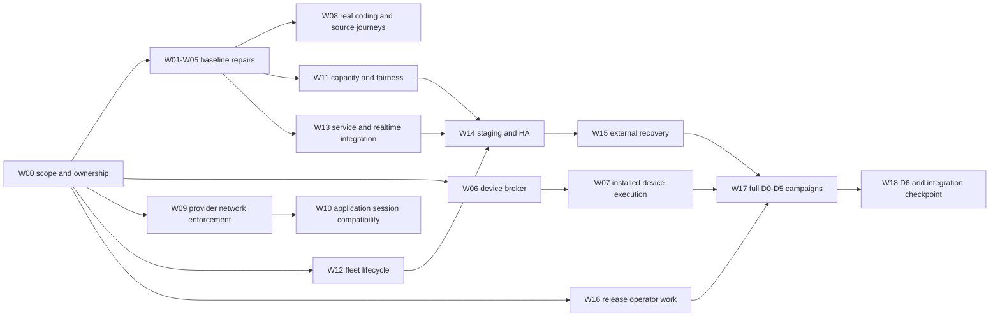

# Replatform Completion Implementation Plan

> **For agentic workers:** REQUIRED SUB-SKILL: Use superpowers:subagent-driven-development or superpowers:executing-plans to implement this plan task-by-task. Steps use checkbox (`- [ ]`) syntax for tracking. This request authorizes the plan, not implementation or new deployments.

**Implementation authorization, 2026-10-16:** TK authorized W00 followed by W01/W03/W04 and local/CI verification. Environment rebuilds and live campaigns remain separate. Current implementation/check evidence is tracked in [PR #692](https://github.com/tandavkrishna27/AoA/pull/692); pending checks and live acceptance must not be inferred from the completed implementation items below.

**Validation follow-up, 16 October:** A later, separately user-authorized fresh Windows/VPS run tested application `05522b0f22e9df84ddfa6d3444d0362e4ad8a6cd`. Its [immutable report](../reports/2026-10-16-local-vps-validation-report.md) and [pickup checklist](2026-10-16-local-vps-validation-handoff.md) distinguish verified work, pending fixes and deferred gates, including the user's successful task-creation retry with an unresolved Planning-mode mismatch. This does not rewrite the historical baseline or close W01 native end-to-end/W04 lifecycle/W05 artifact acceptance by implication.

**Goal:** Finish the outstanding replatform functionality and reliability work identified by the 15 October tests, then prove the supported product and release requirements on a new candidate.

**Architecture:** Preserve one logical control-plane authority per environment, with enrolled workers and independently fenced execution. Extend the existing routing, broker, sandbox and output paths; keep personal device credentials on the device. Reuse shipped implementations and repair demonstrated gaps before widening deployment or workload exposure.

**Tech Stack:** TypeScript, Node 24 CI, pnpm 9.15.4, Vitest, PostgreSQL/Drizzle, Docker, worker-protocol v1, adapter-manager, E2B, Playwright and the existing desktop keystore/host packages.

**Spec:** [Immutable test report and findings](https://github.com/tandavkrishna27/AoA/blob/c065cdc89/docs/aoa/qa/replatform-2026-10-15/REPLATFORM-TEST-REPORT.txt), [normative test gates](../../replatform/test-gates.md), [current M1/M2 implementation](../../replatform/m1-m2-code-execution.md), [M3 implementation](../../replatform/m3-code-execution.md), [M4 implementation ledger](../../replatform/m4-code-execution.md), [M4 requirement audit](../../replatform/m4-requirements-evidence.md), and [milestone allocation](../../replatform/epic-regrooming/scope-triage.md). The raw historical QA package remains unchanged on `docs/testing-results-2026-10-15`; it is not copied into this implementation branch. These existing contracts govern this plan; it does not approve new architecture or waive a gate.

## 1. Baseline and what completion means

Prepared 16 October 2026, Asia/Calcutta, from tested application revision `13b4e806f31a67c3c172f2216272570203132f8f`. The report was published in `c065cdc8951784980fb0951b9e6f8f0d5338b73a` on `docs/testing-results-2026-10-15`. Both remote heads were checked while preparing this plan: the program branch still points to the tested application revision, and the report branch still points to that report commit before this plan is added. Later implementation must recheck HEAD and superseding fixes before assigning work.

Yesterday established substantial component behavior, not release acceptance. The complete normal Node 24 run had 2,518 passing / five failing / 227 skipped files, 24,332 passing / four failing / 2,063 skipped tests, and one unhandled error. The Windows database/process lane had 121 passing / two failing files and 1,458 passing / six failing / two skipped tests, derived from all per-file reports; its final native summary and unhandled-error count were not captured. Focused passes do not replace either failing whole-lane result.

There are two delivery outcomes:

1. **Engineering completion:** supported defaults work, required tests are stable, actual app-originated distributed jobs produce usable outputs, and the explicitly selected device/browser/provider capabilities work with their security boundaries. Component implementation and bounded integration evidence can be completed before formal release campaigns.
2. **Release completion:** applicable D0–D5 evidence and the all-workload D6 campaign pass for the same candidate, with the governed integration and owner decisions. A working coding demo cannot replace browser, service, HA, recovery or beta acceptance.

The local and VPS test installations have been torn down. Docker data was fully pruned at the user's request. No former port, container, test database, auth home, provider configuration or VPS installation is an available prerequisite. Execution must provision fresh disposable resources when needed; this plan itself installs nothing. The preserved report is the historical evidence.

## 2. Global constraints

- Preserve tenant/company scope, approval, budget, audit, current lease/fence authority and the hard invariants in `test-gates.md`. No secret bytes in evidence, no personal credential copying to the VPS, and no tenant-command fallback onto a worker or cloud control-plane host.
- Two independent AoA databases are separate authorities. Test VPS-to-PC and PC-to-VPS as separate enrollment configurations, not as peer application federation. Replicas of the same authority share the required durable substrate.
- Node 24 is the required PR workflow runtime. Reproduce yesterday's failures on Node 24.19.0 first; qualify the actual advertised runtime/OS matrix separately. Do not change the user's global Node or Codex installations to satisfy a test.
- Use frozen pnpm 9.15.4 installation. Manifest and lockfile changes travel together; never repair the Playwright issue with hoisting or a lockfile-only edit.
- Keep frozen protocol and package boundaries. Any necessary wire-contract change follows the repository conformance/baseline process and applicable N/N-1 acceptance; do not silently add fields to frozen v1.
- Build workspace packages before tests; run the authoritative root `pnpm build` as well as required types/tests. FND-005 already landed: do not invent the obsolete conditional catalog-refresh attestation as new work.
- Keep production rollout flags off until the corresponding path has evidence. The existing M1 amendment does not require separate certification paperwork for internal engineering progress; full release requirements still apply at release.
- Anthropic-backed M1b live testing remains deferred by the recorded founder instruction. Do not request a replacement key or substitute another paid model provider. Continue independent code and keyless work. A separately approved credential cohort is required before other paid model campaigns begin.
- Credentials go into protected runtime configuration, not Git, logs or chat. Provider spending starts with deterministic tests, then a bounded smoke, then a separately prepared campaign with counts, cleanup and cost controls. No campaign is launched by this plan.
- Keep original failures and immutable QA records. New attempts identify the candidate, command, native exit, counts, errors, duration and scope. A skip, unknown final count or incomplete profile is not a pass.
- Use the current ledgers before old epic headers. Do not reopen DEP-009, the existing kill-switch API, landed service checkpoint behavior or the already passing restore components merely because their broader operational gates remain open.

## 3. Review focus

| Input or failure mode | Expected behavior | Owning work package |
|---|---|---|
| Stored model was once valid but is unavailable to the current subscription/CLI | No automatic API billing fallback; a supported inherited default or an actionable configuration refusal | W01 |
| An ACL test times out while its database mutation loop is still running | Mutation stops, roles are restored, and the next test has an independently healthy fixture | W04 |
| Export, deadline and destroy occur concurrently | The defined ownership/error contract holds, every promise is observed, and no late artifact is promoted | W05 |
| The PC loses control-plane access while retaining public Internet | Next governed effect is denied and per-job credential activation expires; personal login alone confers no job authority | W06–W07 |
| A noisy tenant eventually finishes after the deadline, or a request disappears before completion logging | The original miss remains a failure and the request remains in the denominator | W11 |
| A source works with a company key but is unavailable with a personal credential or selected target | Each supported source/caller combination has its own positive journey; unsupported combinations refuse without fallback | W00, W07–W08 |
| A later Commander turn resumes retained state after restart, credential rotation or competing ownership | Current authority and fresh credentials govern resume; old authority cannot execute, leak historical credentials or spawn a second executor | W08 |
| A service/beta probe is missing, late or lacks its support-row dimensions | Late success remains a failed scheduled sample; missing evidence fails the gate and cannot improve availability | W13, W18 |
| Browser journeys pass for an agent but not a human Commander, or approval times out | Both supported caller/session variants pass their own approval, evidence, cancellation and isolation cases | W09–W10 |
| An image is built successfully but lacks approved provenance or a passing vulnerability report | The real promotion path refuses it before release publication; a test-root pipeline cannot authorize production | W16 |

## 4. Workstreams and order

The W identifiers below are planning identifiers, not newly filed repository tickets. Owner columns identify the responsible discipline; the program owner assigns actual people and approved ticket ownership at W00.

| Disposition | Work | Assignment rule |
|---|---|---|
| Confirmed immediate repair | W01 retired model defaults; W03 dependency resolution | Start bounded regression/fix PRs first |
| Diagnose before choosing a product edit | W02 crew failure; W04 fixture failures; W05 artifact races; W11 capacity | Reproduce and isolate the cause; retain original failing evidence |
| Missing user-facing capability | W06 device broker; W07 personal device execution | Implement the existing security contract and actual application journey |
| Provider or application compatibility dependency | W08 capability disposition/coding cohort; W09 enforcement; W10 issuer | Prove the selected capability and fix demonstrated integration gaps; do not manufacture support |
| Primarily validation, infrastructure or release work | W12–W18 | Reuse landed components; file code work only for a measured residual or missing campaign driver |

| Wave | Work packages | Main deliverable |
|---|---|---|
| A: restore a trustworthy baseline | W00–W05 | Model/crew fixes, dependency repair, reliable fixtures and artifact contract |
| B: finish selected capabilities | W06–W10 | Device subscription execution, actual coding source journeys, governed browser capability |
| C: prove operational behavior | W11–W15 | Capacity correction, fleet lifecycle, service/realtime evidence, staging HA and external recovery |
| D: release readiness | W16–W18 | Operator/release work, exact-candidate campaigns and governed acceptance |



Work can overlap where dependencies permit: models/crew, fixture repair, desktop broker, browser enforcement feasibility, service/realtime integration, and release ticket scoping are separate lanes. W11 measurement work and W14 infrastructure preparation can start early; their final acceptance needs the repaired candidate and actual workload prerequisites. Coding and browser acceptance need their own prerequisites. W17's cheaper D0/D1 work can start before staging is ready; its D5 portion cannot. Prepare W18's schedule driver and dry-run verdict checks alongside W13 before the release-candidate gates freeze; W18's live campaign still waits for all applicable same-candidate entry gates. The desktop edge applies when that surface is advertised; W00 must explicitly disposition it.

### Testing environments and per-item assignment

The routes below assign testing infrastructure, not permission to deploy or launch a paid campaign. Run deterministic checks before live integration. Provision fresh disposable resources; the previous local/VPS installations are unavailable.

- **LOCAL/CI:** developer fixtures, native Windows checks and the required Linux CI lanes. A live provider or application issuer is an explicit prerequisite where stated; a skipped/keyless fixture cannot establish that live result.
- **LOCAL + VPS:** an actual PC worker and remote VPS authority, with a separately configured local authority/remote worker for the supported reverse direction. Each experiment has one logical authority; two independent application databases never federate. Enrollment, network access and credential custody must be configured for that experiment.
- **EXPANDED STAGING:** W14's production-equivalent D5 topology: at least two control planes behind the load balancer, four workers across two real failure domains, external stores and the specified shared services. W18 adds the external beta participants and calendar campaign. The former two-machine setup alone does not establish this environment.

**VPS/provider (PC optional)** below identifies a hosted/provider-only route. It can use a suitable Linux CI runner or VPS with the declared prerequisites; it does not require a PC worker or the full D5 topology. Actual application-issuer staging is still required for W10.

| Work item | Required testing route | Scope and condition |
|---|---|---|
| W00 scope/ownership | LOCAL/CI planning | Assign support rows, case IDs, owners and infrastructure; no live execution in this item. |
| W01 model defaults | LOCAL/CI | Resolver regressions and fresh native subscription onboarding; changed behavior is also exercised by W07/W08. |
| W02 native crew | LOCAL/CI | Real local background tool/task effect, signing configuration, cancellation and restart. |
| W03 Playwright parity | LOCAL/CI | Clean strict install, package suite and deliberate pin-mismatch negative control. |
| W04 fixture/capture reliability | LOCAL/CI | Isolated and interacting Windows/PostgreSQL tests, required Linux CI and complete native output. |
| W05 artifact ordering/output | LOCAL/CI → LOCAL + VPS | Controlled race regressions, then the explicit VPS-authority → PC-worker real-file/export/download journey. |
| W06 device credential broker | LOCAL/CI → LOCAL + VPS | Broker/OS denial fixtures, then real device activation, authority partition with Internet retained, revocation and restart. |
| W07 installed-device execution | LOCAL/CI → LOCAL + VPS | Advertised OS/installer checks and actual app-to-PC subscription execution; reverse direction only with the remote worker's supported modes. |
| W08 coding/source journeys | LOCAL/CI → VPS/provider; LOCAL + VPS for enabled personal-device rows | Test every selected source/caller/credential/target combination, including warm Commander continuity. Real D2 needs its approved provider/template/credential cohort, not necessarily a PC. |
| W09 browser network enforcement | LOCAL/CI (Linux) → VPS/provider | Kernel/socket tests plus actual provider-wide egress probes. Include PC execution only for an advertised desktop-browser row. |
| W10 browser application sessions | LOCAL/CI → VPS/provider with actual issuer staging | Real caller/session variants and full D3 journeys; PC required only when the selected supported row executes there. |
| W11 capacity/fairness | LOCAL/CI → live-daemon diagnostic → EXPANDED STAGING | LOCAL + VPS can supply the bounded diagnostic; full D5 load/fairness acceptance requires W14. |
| W12 worker retirement/restored identity | LOCAL/CI → live fleet → EXPANDED STAGING | LOCAL + VPS is suitable for representative remote lifecycle checks; final restored-fleet evidence runs on W14/W15's topology. |
| W13 service/realtime | LOCAL/CI → live provider/replicas | LOCAL + VPS is suitable when the worker is remote. Realtime needs two shared-authority replicas; D4 needs 72 hours and its full fault schedule, but not inherently D5 topology. Repeat applicable legs during W17 D5. |
| W14 topology/HA | LOCAL/CI → EXPANDED STAGING | Render/invariant checks first, then actual failure domains, load balancer, stores, running fleet and measured HA. |
| W15 external recovery | LOCAL/CI → EXPANDED STAGING | Retain restore regressions; external-store RPO/RTO, quarantine and restored-fleet acceptance require W14. |
| W16 release/operator controls | LOCAL/CI → live control plane/worker → EXPANDED STAGING | Pipeline refusal tests run in CI; LOCAL + VPS can exercise bounded remote kill/drain. Final rollout/rollback rehearsals use the release topology. |
| W17 exact-candidate gates | LOCAL/CI + selected live routes + EXPANDED STAGING | D0: local/CI; D1: isolated distributed fixture with at least two workers; D2–D4: declared real providers/issuer/replicas, plus LOCAL + VPS for device rows; D5: expanded staging. |
| W18 beta/handoff | EXPANDED STAGING; LOCAL + VPS for advertised device rows | Same-candidate upstream gates, at least three external organizations, frozen probes and 14 consecutive calendar days. |

Record the chosen route, exact topology and executed case IDs in each new attempt. A host placement label is not proof of execution there. Reuse prior evidence only at its recorded candidate and scope; the expanded-staging and calendar gates cannot be closed by a smaller smoke.

## 5. Work packages

### W00 — Resolve scope, ownership and acceptance inputs

**Type / owner:** Planning and evidence reconciliation / program owner with engineering and QA. **Inputs:** P13, P21–P23; current ledgers.

**Files:** Read `docs/replatform/epic-regrooming/scope-triage.md`, `docs/replatform/test-gates.md`, `docs/replatform/epics/E11-hardening-release/implementation-plan.md`, `docs/replatform/epics/E10-desktop-migration-realtime/tickets/MIG-001-target-credential-routing.md`, and `docs/replatform/m4-requirements-evidence.md`. Record decisions in the existing owning decision/plan files, not historical QA results.

**Produces:** A release-scope disposition and support-row families using D6-04's nine existing dimensions; source-specific case IDs beneath each applicable family; a role owner and acceptance ID for each W item; a recommendation for the program owner's full-D2 assignment; and measured scope for the unwritten release tickets. No D6-04 row IDs exist in the repository today, and no participating beta Organizations have been selected, so this planning record does not mint fake Organizations or claim to freeze the campaign matrix. The Release Owner materializes stable per-Organization row IDs only after participants and exact provider/target/OS values are known. Preserve any IDs already present if that changes. Do not add a device dimension or change the frozen wire contract.

- [x] Compare the current program HEAD with the tested SHA. Plan baseline: tested application `13b4e806f31a67c3c172f2216272570203132f8f`; W00 review HEAD: `5b96f1d39c5dbf22550245aedc1e04793b10be4c`. The code diff from the tested SHA is empty: MIG-001's implementation checkpoint and the M4 component fixes were already present at the tested SHA, and no finding fix landed since. The only intervening changes are report/plan documentation. Preserve the report's original findings and test limitations; no historical QA record is rewritten. Recheck HEAD before each implementation begins.
- [x] For COV-01, assign these source/caller case IDs and route each to the support-row family below. These are planned acceptance cases, not execution results. A positive route remains unproven until its work package records same-candidate evidence. Every unlisted source × credential × target combination is outside advertised scope and must fail closed.

  | Case ID | Source and caller variant | Selected credential / target | Acceptance disposition and route |
  |---|---|---|---|
  | `COV01-TASK-CLOUD-KEY` | `task_run`, task agent | Company key / supported cloud worker | Positive coding case; W08 then W17, LOCAL/CI → VPS/provider. |
  | `COV01-CREW-CLOUD-KEY` | `crew_run`, crew agent | Company key / supported cloud worker | Positive coding case; W08 then W17, LOCAL/CI → VPS/provider. |
  | `COV01-CMD-HUMAN-COLD-KEY` | `commander_turn`, human Commander, cold | Company key / supported cloud worker | Positive coding case; W08 then W17, LOCAL/CI → VPS/provider. |
  | `COV01-CMD-HUMAN-WARM-KEY` | `commander_turn`, human Commander, warm | Company key / warm-capable supported cloud worker | Positive only on a selected warm-capable backend; W08 then W17, LOCAL/CI → VPS/provider. |
  | `COV01-CMD-AGENT-COLD-KEY` | `commander_turn`, task-agent caller, cold | Company key / supported cloud worker | Positive coding case; W08 then W17, LOCAL/CI → VPS/provider. |
  | `COV01-CMD-AGENT-WARM-KEY` | `commander_turn`, task-agent caller, warm | Company key / warm-capable supported cloud worker | Positive only on a selected warm-capable backend; W08 then W17, LOCAL/CI → VPS/provider. |
  | `COV01-ONESHOT-CLOUD-KEY` | `one_shot`, agentless extraction | Company key / supported cloud worker | Positive case after W01/W05/W08; LOCAL/CI → VPS/provider. No sentinel agent or task. |
  | `COV01-BROWSER-TASK-KEY` | `browser_request`, task agent | Company key / supported browser worker | Positive browser case after W09/W10; LOCAL/CI (Linux) → VPS/provider. |
  | `COV01-BROWSER-CMD-KEY` | `browser_request`, authenticated human Commander | Company key / supported browser worker | Positive only where the actual issuer/session path supports it; W09/W10, LOCAL/CI (Linux) → VPS/provider with actual issuer staging. Anonymous describes destination browsing, never an anonymous AoA caller. |
  | `COV01-SERVICE-RECONCILE-KEY` | `service_reconcile`, service owner | Company key / supported service worker | Positive service case after W13; LOCAL/CI → live provider/replicas. |
  | `COV01-PERSONAL-CLOUD-DENY` | Any selected cloud source | Owner personal subscription / cloud target | Explicit unsupported-route denial; no personal auth-home copy or company-key substitution. LOCAL/CI plus denial check in W06–W08. |
  | `COV01-PERSONAL-WINDOWS` | Requested Windows app-to-PC delegation journey | Owner personal subscription / owner device | Engineering outcome remains requested; W06/W07 positive application journey is a hard predecessor to claiming this capability. Device target is not advertised in this release. LOCAL/CI → LOCAL + VPS. |
  | `COV01-DESKTOP-DENY` | Any source requiring an installed desktop target | Any credential / desktop target | Release row disabled; W06/W07 negative tests prove no enrollment, lease, route or fallback can advertise/invoke desktop. DSK-00 permits this scope. |
  | `COV01-MOBILITY-DENY` | Cross-target handoff | Any credential / source→destination target | Release row disabled; negative API/UI/route/fallback evidence per D6-05. No handoff or target re-placement is claimed. |

  D6-04 row families (not frozen campaign rows): coding, browser and service each require one family for every participating Organization. Each eventual row records Organization, workload, target class, provider, OS/version or `not_applicable`, credential-binding mode, locality, allowed fallback and mobility. Current intended cloud families use company-key binding, cloud locality, no implicit host fallback, and mobility `disabled`; exact provider/template/OS and Organization values stay pending until their owners select them. The personal-Windows engineering case is deliberately not an advertised D6 row. D6-04 currently defines no device/enrollment field (E11-F006); do not add one under W00.
- [x] Preserve the Windows personal-subscription delegation engineering outcome and separately disposition release exposure: installed desktop and cross-target mobility remain **disabled for this release**, with DSK-00/D6-05 negative evidence required. DSK-00, D6-03 and D6-05 already permit a cloud-only, non-mobile beta. No advertisement, activation, migration, or mobility claim is authorized by this planning record.
- [x] TK assigned full D2 to **M4** on 2026-10-16 in this implementation session; recorded in `docs/replatform/epic-regrooming/scope-triage.md`. M4 has the same-candidate D5 integration context before M5/D6 entry; the three full D2 campaigns consume the stable coding/provider/credential cohort produced by W08, while W08's bounded product journey and M1 partial gates do not substitute for full D2. Keep the 2026-10-06 Anthropic deferral intact; no replacement key, paid-provider substitute or campaign launch is authorized.
- [x] Scoped the unwritten release tickets from their current owning files. `REL-001` retains the existing cross-tenant/secret-exposure gate across coding, browser and service, with `BRW-006`, `SVC-007`, `TEN-005`, and `DEP-008` predecessors. `REL-002` retains the exact program-design scope: queue/lease/event/artifact/service-reconciliation limits and initial SLOs; noisy-Organization fairness, predictable overload behavior, and bottleneck metrics, dependent on `JOB-007`, `JOB-009`, `DEP-009`, and `SVC-006`. `REL-005` remains the M5 selected-Organization beta campaign/evidence pack after `REL-001`…`REL-004` and D6-01 closure, with its own Step 0 after the actual D6-04 matrix. Keep all three deferral-manifest entries until the corresponding governed Step 0 design is filed, and remove only the matching entry in that same filing commit. Do not copy stale kill-switch-write-path wording into REL-005; current W16 must resolve the remaining operator UI/drain-integration decisions. COV-05's scanner, protected production root and publish-path admission remain REL-004 residual scope pending a named release/platform owner and approved root/gate policy. No ticket was filed and no deferral was removed in W00.
- [x] Program owner selected M4 for full D2. The existing disabled desktop/mobility release scope is retained. W01/W03/W04 proceed with the prepared case map; no live scenario is their hard predecessor. Named release/platform staffing and exact beta participant/provider rows remain inputs to W16/W18, rather than invented assignments or release acceptance.

| Work | Responsible owner (role, not an invented person) | Acceptance ID | Predecessor and test route |
|---|---|---|---|
| W00 | TK — program decision owner; Codex — implementation/evidence coordinator | `W00-SCOPE` | Current ledgers; LOCAL/CI planning. Full D2 assigned M4. |
| W01 | Adapter + native app engineering | `TST-008`, preserve scoped `TST-004` | W00 case map; LOCAL/CI, then native subscription onboarding if available. |
| W02 | Native app + crew engineering | `TST-009` | W01 for live acceptance; LOCAL/CI. |
| W03 | Browser-runtime engineering | `TST-002` | W00; strict install + package suite, LOCAL/CI. |
| W04 | Test-infrastructure engineering with DB/security review | `TST-003`, `TST-011`, `TST-014`–`TST-016` | W03 before whole-suite acceptance; Windows + required Linux CI, LOCAL/CI. |
| W05 | Adapter-manager + worker-output engineering | `TST-012`, `TST-013` | W00; controlled race tests, then LOCAL + VPS for live output journey. |
| W06 | Desktop security + credential engineering | `TST-005`, P01 | W00; LOCAL/CI then LOCAL + VPS. |
| W07 | Desktop + routing engineering | P01, P10, P21 | W01/W05/W06; LOCAL/CI then LOCAL + VPS for the requested Windows positive journey. |
| W08 | Coding adapter + source owners | `TST-006`, COV-01/COV-02 | W01/W02/W05 and selected cohort; LOCAL/CI → VPS/provider; LOCAL + VPS only for any later advertised personal-device row. |
| W09 | Browser + provider security engineering | COV-03, BRW-008 | W00 provider family; Linux LOCAL/CI → VPS/provider. |
| W10 | Browser + application-auth engineering | D3-02–D3-06, COV-03 | W09 and actual issuer staging; LOCAL/CI → VPS/provider. |
| W11 | Control-plane + worker performance engineering | `TST-010`, D5-L01–L06 | W03–W05 baseline; LOCAL/CI → live-daemon diagnostic → expanded staging. |
| W12 | Worker + enrollment engineering | P07, WRK-016 | W00 migration disposition; LOCAL/CI → live fleet → expanded staging. |
| W13 | Service + realtime engineering | P10/P15, COV-04 | E9/realtime prerequisites; LOCAL/CI → live provider/replicas. |
| W14 | Platform + SRE | P16/P17, D5-00/HA | W11–W13; LOCAL/CI → expanded staging. |
| W15 | DB + storage + platform engineering | P19, D5-DR01–DR07 | W12/W14; LOCAL/CI → expanded staging. |
| W16 | Release + product + platform owners; named COV-05 release/platform owner still required | P22/P23, COV-05 | W00 and current REL-004 records; LOCAL/CI → governed release integration. |
| W17 | QA/campaign execution with gate owners | D0–D5 and COV-01–COV-05 | Each applicable gate predecessor; declared LOCAL/CI/provider/staging route per gate. |
| W18 | Release owner, on-call, support and gate owners | D6-01–D6-14, REL-005 | W16/W17 and frozen D6-04 matrix; 14-day external campaign. |

### W01 — Fix model availability and default resolution

**Type / owner:** Confirmed product defect / adapter + native app engineering. **Finding:** TST-008; retain TST-004 as a scoped historical pass. **Dependency:** W00's credential matrix.

**Files:** `packages/adapters/codex-local/src/index.ts`, `packages/adapters/codex-local/src/server/resolve-chat-model.ts`, `server/src/services/internal-agent/codex-model.ts`, `server/src/adapters/codex-models.ts`, `server/src/routes/cli-auth.ts`, `ui/src/components/AgentConfigForm.tsx`, and their existing Codex model/auth tests. Add a package-local model-availability helper and tests if needed; preserve the declared server/adapter package boundary.

**Interfaces:** Keep `resolveCodexChatModel(configModel, sharedModel): string` callers synchronized during migration. Separate identifier syntax/CLI compatibility from account availability. The API-key `/v1/models` catalog is not proof that a subscription can use a model. Catalog/cache inputs must be scoped to the actual CLI version, auth mode and managed auth home; never share one account's availability across companies.

- [x] Add regression cases for empty config, a stored retired default, explicitly selected unavailable model, API-only entry under subscription auth, catalog outage, account change, malformed identifier, and mismatched CLI/catalog identity. Assert that no API-key fallback or unsafe model reaches execution.
- [x] Resolve inherited defaults against the pinned client's supported account catalog. Preserve a valid explicit selection; surface an actionable refusal for an unavailable explicit selection. Do not blindly rewrite stored agent/company configurations whose selection provenance is unknown.
- [x] Update the duplicated server/adapter resolver, model picker, auth verification and managed config generation consistently. Yesterday's successful `gpt-5.6-luna` is a historical probe result, not a permanent future default. The existing pinned CLI supports `model/list`; its catalog establishes compatibility, not inference entitlement. No CLI pin upgrade is needed.
- [x] Run the existing resolver, model-routing, environment and CLI-auth regressions, plus authorized per-agent picker and company/credential-boundary tests. Fresh Codex configuration stores an inherited blank; unknown-provenance saved selections remain explicit and are never backfilled.
- [ ] Run a fresh native subscription onboarding → verify → Commander → crew → extraction smoke with no test-company model override. Required TST-008 acceptance is deferred to the separate [live-validation plan](2026-10-16-local-vps-validation.md) after local/CI verification and a fresh application setup. No suitable live application was rebuilt or exercised during this implementation. Reopen TST-004 only if its scoped behavior regresses.

### W02 — Diagnose and repair native background crew operation

**18 October adapter follow-up:** [adapter report](../reports/2026-10-18-w02-adapter-variants-report.md), [portable evidence](../evidence/2026-10-18-w02-adapter-variants-summary.json) and [checklist](2026-10-17-w02-w05-handoff.md). Application `5a2ed274c` repairs demonstrated Claude/Gemini structured-failure handling, Gemini model identity, three-adapter timeout metadata, OpenCode stdio bearer-alias stripping and supervised heartbeat Codex app-server child teardown. Exact-candidate targeted local/VPS tests and affected-package builds/typechecks pass. Real subscription/API-key/vendor-CLI validation is skipped at the user's request; non-Codex tool-name auditing, per-variant live acceptance and deferred crash custody remain open. Full W02 exit remains unchecked.

**18 October bounded follow-up:** [authority/audit/shutdown report](../reports/2026-10-18-w02-authority-audit-shutdown-report.md), [portable evidence](../evidence/2026-10-18-w02-followup-summary.json), and [completed/pending checklist](2026-10-17-w02-w05-handoff.md). Core signed AoA HTTP/native-stdio authority/revocation checks, transactional entity-scoped curation audit and graceful tracked-child drain are now repaired and verified locally/on rebuilt VPS. Actual native Steward run `d14aaca4-4b33-4266-baab-5ccc78cf2d15` has useful curation, matching revision audits and exactly one cost event. The user explicitly deferred durable abrupt-crash custody to a separate design; untested native adapter variants remain open, so the full package exit below remains unchecked.

**17 October bounded follow-up:** [targeted repair report](../reports/2026-10-17-w02-w05-targeted-report.md) and [completed/pending checklist](2026-10-17-w02-w05-handoff.md), branch `codex/replatform-w02-w05`. Native Steward now performs a durable authenticated curation effect with observed tool names and one subscription cost event. Prompt context, accounting/provenance and same-process child cancellation defects are repaired. Existing signing setup works; no second secret store was needed. Full live revocation/negative-boundary/crash-restart/adapter coverage and global mutation-audit reconciliation remain pending, so the broader exit below is not marked complete.

**Type / owner:** Investigation, then only demonstrated code/config fixes / native app + crew engineering. **Finding:** TST-009. **Dependency:** W01 for live model acceptance.

**Files:** `server/src/agent-auth-jwt.ts`, `cli/src/config/env.ts`, `cli/src/checks/agent-jwt-secret-check.ts`, `cli/src/commands/onboard.ts`, `server/src/services/internal-agent/aoa-agents/crew-codex-auth.ts`, and the existing crew/sweep tests. Read the originating sweep run and failure before selecting additional files.

**Consumes / produces:** The existing persistent agent-signing configuration and actual crew-run identity; a background run whose authenticated tool effects and result attribution survive restart.

- [ ] Reproduce `sweep.steward` independently of a Commander response and record the actual error chain. Test missing signing configuration, a healthy persisted key and wrong/stale run JWTs with deterministic fixtures. The observed warning is not proof of cause.
- [ ] Use the existing onboarding/doctor repair path to create and reload persistent signing configuration. Fix production initialization only if the normal path omits it; do not add a second signing-secret store.
- [ ] Repair the demonstrated auth, model or lifecycle cause. Exercise one permitted real task/tool effect, denial for another company, permission revocation, expired JWT, cancellation and restart.
- [ ] Run focused crew/auth tests plus an app-originated background run with a durable result and exactly one cost/audit attribution. **Exit:** the background path succeeds independently; setup-only repairs are recorded as such, not as product bug fixes.

### W03 — Repair strict-install Playwright parity resolution

**Type / owner:** Reproduced test/dependency defect / browser-runtime engineering. **Finding:** TST-002.

**Files:** `packages/browser-runtime/package.json`, `pnpm-lock.yaml`, `packages/browser-runtime/src/__tests__/image-playwright-parity.test.ts`, `e2b/e2b.Dockerfile` only if its actual pin must change.

**Contract:** The version installed in the sandbox image equals the Playwright runtime actually resolved by the declared package dependency; Chromium is installed and asserted during image build.

- [x] Compare against a clean strict frozen install on Node 24.19.0 / pnpm 9.15.4. The original Vitest parity file passed 4/4 on this machine; the historical Vitest failure was not reproduced. A plain Node require from the package's strict context fails to resolve the undeclared direct `playwright-core` import, while resolution through declared `playwright` succeeds. Keep a deliberate image/runtime pin-mismatch negative control.
- [x] Resolve `playwright-core/package.json` through the declared `playwright` dependency's require context, rather than relying on a root/transitive hoist. Keep the declared runtime dependency and exact image/version comparison; no new package is needed for this resolution-only approach.
- [x] Run the parity file and browser-runtime package suite: 5/5 parity tests; 175 package tests passed with 19 existing skips. The real match passes; an intentionally mismatched fixture fails, and Chromium assertions remain active.
- [x] Commit the resolution-only fix (`72e980eb6`); manifests and lockfile remain unchanged. **Exit:** fresh strict installation resolves the parity assertion without weakening it.

### W04 — Make fixture lifecycle and test-result capture reliable

**Type / owner:** Diagnosis and harness repair / test infrastructure with DB/security review. **Findings:** TST-003, TST-011, TST-014, TST-015, TST-016. **Dependency:** W03 before whole-suite acceptance.

**Files:** `server/src/__tests__/distributed-execution-db-startup.integration.test.ts`, `server/src/__tests__/job-submission.integration.test.ts`, `server/src/__tests__/cloud-plugin-process-composition.test.ts`, `server/src/__tests__/job-leasing-contract.test.ts`, `packages/db/src/__tests__/required-migration-identity.test.ts`, `ui/src/__tests__/ProjectDetailWorkspaces.test.tsx`, and the affected log-sink/M1 liveness fixtures. Add `scripts/run-vitest-captured.mjs` and `scripts/lib/__tests__/vitest-capture.test.mjs` for reusable native-output capture. Change production code only after isolating a product cause.

**Interfaces:** The capture command forwards arguments to the workspace Vitest entry point, writes stdout/stderr without PowerShell reinterpreting them, and propagates the native exit/signal. Its result records unknown counters as unknown. An aborted ACL fixture must settle its mutation loop and restore roles before teardown completes.

Split implementation into separately reviewable commits: output capture; ACL/startup isolation; async log/UI/liveness observation; import/AST diagnostic correction.

- [x] First add a capture self-test whose child writes both streams and exits nonzero; assert complete output and exact exit propagation. Also test bounded backpressure with multi-megabyte streams, slow sinks, spawn/capture failures and platform-specific signals/write failures. Preserve the original Windows whole-lane limitation rather than reconstructing an invented final summary.
- [x] Investigate the exhaustive ACL sweep and subsequent operator/child assertions in separate fresh databases. The original quiet sweep passed in 217.76 seconds, so its historical timeout was not reproduced in isolation. Split the exhaustive campaign into relation cases, probe both applicable serving roles, stop and await mutations on abort, restore grants, and compare the complete healthy ACL/ownership snapshot. Intentional mid-sweep abort and the next healthy startup pass. The full 149-test startup file passes on Windows and in the required Linux verification lane; the original grouped failures are not classified as independent security defects.
- [x] Replace fixed sleeps/swallowed read errors in log evidence with an observable flush/completion boundary. Assert the positive `job_submission_internal_error` marker before checking absence of SQL/stack/secret canaries. Pin UI readiness to the state actually used by Archive; retain the renewed/stale heartbeat regressions (13/13). Keep the original behavior assertions.
- [x] Diagnose app-import and whole-tree AST costs separately from fixture contamination and process load. Extract pure migration-identity loading without importing the DB runtime; replace the unsupported eager Vitest app import with the real production composition checker plus runtime process controls. Strengthen that checker to reject every constructor outside the guarded body, with mutation tests. The isolated AST contract test passes without weakening it or extending timeouts. Normalize one source-shape fixture's line endings for Windows/CI parity.
- [x] Run affected files separately, then their interacting group, then three clean critical-suite executions on the same candidate under the declared normal concurrency. Frozen application/critical-test candidate `b852f81b670fed099ab5e4669c569f94b600f638`, Node 24.19.0 / pnpm 9.15.4, Windows integration opt-in and two Vitest workers: each run passed all 9 files and 295 tests, with 13 existing workspace-runtime platform skips, zero unhandled errors and clean post-abort state. Native durations: 595.24 / 477.10 / 483.63 seconds. Each bounded repair is committed independently; interrupted/superseded attempts are retained but not accepted.

**Verification boundary:** The same frozen candidate passes recursive typecheck, authoritative `pnpm build`, and the complete normal Windows suite (2,526 files / 24,363 tests passed; 227 files / 2,131 tests skipped). Required Linux verification shards, including full startup and capture self-tests, pass. Overall PR/CI status and the E2E fixture follow-up are recorded in [PR #692](https://github.com/tandavkrishna27/AoA/pull/692); synthetic catalog/browser fixtures do not establish native subscription entitlement or close TST-008's separately required live journey. Subsequent E2E fixtures and the Linux catalog-preflight PATH correction are tracked with current-head validation in that PR. The PATH correction must preserve explicit credential selection and strip ambient provider keys; historical results above remain scoped to their recorded candidate.

### W05 — Settle artifact export/deadline/destroy ordering

**17 October bounded follow-up:** [targeted repair report](../reports/2026-10-17-w02-w05-targeted-report.md) and [completed/pending checklist](2026-10-17-w02-w05-handoff.md). Controlled artifact fixtures and explicit fail-closed executable/staging upload-origin configuration are repaired and tested locally/on VPS. Original historical production-leak attribution remains unproven. The real VPS-authority → PC-worker generated-file/export/UI-download acceptance and broader lane remain pending; no rollout was enabled and no whole suite was rerun.

**Type / owner:** Reproduced failures plus unproven root causes / adapter-manager + worker output engineering. **Findings:** TST-012, TST-013; I17's `producer_failed` output is an additional integration symptom.

**Files:** `packages/adapter-manager/src/server.ts`, `packages/adapter-manager/src/__tests__/server-artifact-export.test.ts`, `packages/worker-daemon/src/lease/artifact-export.ts`, their sequencer/capability tests, and `server/src/services/job-output-bridge.ts` if the source journey demonstrates an integration defect.

**Interface:** Preserve `createProviderServer(options): Server` and the existing typed wire errors/ownership contract. Define whether an export was admitted before destruction using deterministic barriers; tests must assert that ordering, not a race-dependent error class.

- [x] Add controlled schedules for queued deadline before handler attachment, admitted stalled upload then destroy, destroy before admission, fence replacement and late upload completion. Observe every rejection immediately and assert no `unhandledRejection` is emitted. Verified in the bounded follow-up linked above; this does not reclassify original historical production causes.
- [ ] Determine separately whether TST-012 is a test-observation problem or a production rejection leak, and whether TST-013 violates the intended wire error contract. Fix only the demonstrated layer; do not broaden accepted error classes without a contract decision.
- [ ] Repeat the VPS-authority → PC-worker reference journey with a real generated output file and normal artifact export. Require a committed digest/size, authorized UI download, exact bytes and denied stale/foreign reads. A terminal job with `producer_failed` does not pass this output acceptance.
- [ ] Run artifact/export focused suites and cancellation, destroy and integrity regressions, followed by the whole required lane. **Exit:** zero unhandled errors, deterministic wire outcomes, usable governed output and no orphan upload.

### W06 — Implement the device-local credential activation path

**Type / owner:** Confirmed missing capability / desktop security + credential engineering. **Finding:** TST-005; P01. **Existing contract:** MIG-001, DSK-001/002/003 and gate clause DSK-04. This is distinct from the DSK-004 update ticket.

**Files:** `server/src/services/device-local-broker.ts`, `server/src/services/device-local-activation-policy.ts`, `server/src/services/secret-broker.ts`, their existing tests, the MIG-001 routing implementation, and `packages/worker-keystore/src/` for device-side custody. Proposed new device implementation: `packages/worker-keystore/src/device-local-broker.ts` with tests. Keep the value-returning company-key broker separate.

**Consumes / produces:** The current authorized `DeviceLocalHandoff`, active owner/company/target/fence and current lease deadline. Preserve `DeviceLocalCredentialBroker.activate(input): Promise<DeviceLocalActivation>` and `deactivate(activationId): Promise<void>`: activations contain references, never credential bytes. Reuse `clampActivationExpiry({nowMs, requestedTtlMs, leaseExpiresAtMs})`; wire a trustworthy deadline into the real activation path, which currently has no caller supplying it.

- [ ] Complete a code-local design increment for the pinned CLI's credential/proxy interface and OS custody boundary. Demonstrate whether a trusted device adapter can authenticate while the tenant execution environment cannot read or bypass the credential. If that contract cannot be met, record that mode unsupported and bring the specific limitation to the program owner; copying `auth.json` is not an implementation option.
- [ ] Write denial tests for wrong OS user, owner, organization, target/generation, stale fence, missing/invalid deadline, revoked handle, removed membership and expired activation; include direct broker/egress bypass and credential-canary probes. Owned path/secret validators need the D0 10,000-vector corpus.
- [ ] Implement device-side activation/deactivation and authenticated control-plane deadline/authority delivery without importing server runtime into the constrained worker package. Enforce the immutable owner/target binding and destruction of per-job activation on revoke, expiry and fence loss. Update protocol conformance only if a reviewed wire change is required.
- [ ] Prove the decisive partition case: public Internet remains reachable but control-plane authority is lost; the next governed request is denied and activation is destroyed. Test restart, racing revocation and target replacement. **Exit:** DSK-04 mechanism evidence for the selected mode; the underlying personal login may remain stored but cannot revive expired job authority.

### W07 — Connect the actual app to an installed personal execution backend

**Type / owner:** Missing execution/integration capability plus advertised-platform validation / desktop + routing engineering. **Dependency:** W01, W05, W06; supported CLI/backend decision in W00.

**Files:** `packages/worker-keystore/src/bin/desktop-host.ts`, `packages/worker-keystore/src/bin/sandbox-provider.ts`, `packages/worker-keystore/src/control-effects.ts`, `packages/worker-keystore/src/identity-store.ts`, the existing folder-grant/desktop invocation tests, and `packages/worker-networked-host/src/bin/networked-host.ts` only at its supported composition seam. Use existing DSK-003/004 designs/results before adding installer or updater work.

**Interface:** A registered target reports its real backend and credential capability. A Docker slot that delegates to the remote reference/E2B provider must not claim local personal-CLI execution. Tenant commands remain in an admitted sandbox; the worker host/control plane never becomes an arbitrary command executor.

- [ ] Add placement negatives: unsupported personal mode, no local folder grant, wrong device owner, offline device and disabled desktop flag cannot obtain a runnable lease or fall back to the host.
- [ ] Wire the proven device broker to the least-privilege installed host/backend, using existing enrollment, keychain, outbox, folder grants and lifecycle effects. Bind the actual source job through staging, outputs, usage, audit, approval, cancel and cleanup. Reconcile residuals against current results; do not reimplement shipped desktop controls or installers based on old design terrain.
- [ ] Submit a unique task from the actual remote authenticated AoA app; stop the expected PC worker to prove no execution, then start it and prove device/backend identity, actual subscription-authenticated execution, exact returned output and UI readback. No test-only SQL placement or scripted provider result counts as this acceptance.
- [ ] Execute W00's other enabled personal-device source/caller cases through their actual application entry points, including Commander/crew/extraction only where explicitly supported. Require exact source identity, device/backend attribution, governed output and cost/audit readback for each; prove unsupported combinations refuse without host, cloud or credential substitution. Join these cases to W08 rather than treating the single task smoke as all-source coverage.
- [ ] Repeat on a separate configuration with a local authority and an enrolled remote worker for the credential/backend modes that remote worker actually supports. Do not attempt to export the PC's personal login to the VPS. Exercise cancellation, authority partition, reconnect, stale output quarantine, revoke/uninstall and zero residual resources.
- [ ] For every advertised OS, run DSK-01–DSK-10, including signed install/update/rollback, keychain, 10,000 path cases and the 24-hour offline case. For disabled OS/mobility rows, collect DSK-00 negatives instead. **Exit:** user-requested app-to-PC workflow is proven; broader desktop advertising remains limited to the measured matrix.

### W08 — Finish real coding capability and application-source journeys

**Type / owner:** Integration validation, capability disposition and fixes revealed by it / coding adapter + source owners. **Findings:** TST-006 and TST-005's separate company-key cohort. **Dependencies:** W01, W02, W05 and the selected provider/template/credential cohort; W07 only for personal-device rows.

**Files:** `packages/sandbox-e2b-provider/src/real-transport.ts` and existing capability tests, `e2b/e2b.Dockerfile`, `server/src/services/sandbox-coding-staging.ts`, `server/src/services/job-output-bridge.ts`, current Commander/crew/extraction cutover code and their existing integration suites. Use the E7 ticket ledgers and current M1/M2 ledger to choose residual edits.

**Interface:** The admitted template/CLI capability matrix is truthful. Task, Commander, crew and agentless one-shot extraction preserve their existing source identity, tenant, authority, cost/audit and delivery semantics.

- [ ] Record E2B cancellation/exit-status capability disposition per workload. Use observed forced teardown when graceful process cancellation is unsupported; never report a graceful success or inferred exit code. Reject a workload that requires an unavailable guarantee rather than silently substituting semantics.
- [ ] Test the existing public app routes end to end: useful coding change, founder-retrievable output, Commander result, crew tool/result delivery and agentless extraction. Include approval denial, budget stop, late/duplicate output, interrupted ownership, retries and drain/rollback. No sentinel agent/task may be introduced to make extraction fit.
- [ ] For COV-01, execute every supported W00 coding-source/caller × credential × target case and its declared negative controls. Company-key/E2B results and personal-device results remain separate evidence. A source passing in one credential/target configuration cannot close another row. W10 owns the browser-source variants and W13 the service-source variants.
- [ ] For COV-02, run at least three real application-originated Commander turns in one warm conversation on each selected warm-capable backend. Assert accepted checkpoint/result continuity, exact retained-resource identity, fresh per-turn authority/credentials, target/worker affinity, streamed-versus-durable result consistency and exactly-once cost/audit attribution. Exercise control-plane/worker restart, competing turns, stale or corrupt checkpoint, prior-capability expiry, credential rotation/revocation between turns, and membership/fence loss before resume. Old and current credential canaries must remain absent from output/evidence. Prove drain/rollback never starts a legacy or second executor while the retained owner exists, and idle/TTL retirement reclaims the resource. Keep ephemeral-only backends explicitly scoped under the existing configuration; unavailable warm support cannot satisfy an advertised warm row, and cloud warm behavior cannot be disabled merely to bypass this check.
- [ ] Pin the actual coding template, CLI and empty output-root evidence required by the selected E7 campaign. Re-run its governed template/no-op checks when a template or CLI changes. Keep Anthropic-dependent checks deferred until the founder changes that direction; no reference provider or native local Commander result substitutes for them.
- [ ] Begin with the smallest approved provider smoke, reconcile every created sandbox, then run the owned D2 campaign only after its prerequisites pass. **Exit:** real useful output through every enabled source and honest capability handling. The three sandbox lifecycle tests are retained regression evidence, not full D2.

### W09 — Obtain and verify sandbox-wide browser network enforcement

**Type / owner:** External capability dependency plus provider integration / browser + provider security. **Inputs:** P04, BRW-008, E8-F006; W00's provider matrix.

**Files:** `packages/sandbox-e2b-provider/src/__tests__/keyed-w10b-egress-enforcement-probe.test.ts`, relevant real-transport/browser capability code, `packages/browser-runtime/src/egress-proxy.ts`, `packages/browser-runtime/src/launch-guard.ts`, `packages/worker-daemon/src/supervisor/browser-dispatch.ts`, and the existing provider-attestation composition path.

**Contract:** Browser dispatch requires provider-enforced default deny bound to the admitted policy/provider/template; a host SOCKS proxy or static JSON assertion alone is insufficient.

- [ ] Read the existing keyed enforcement probe/results before changing code. Measure the approved provider's actual default-deny/allowlist behavior, including working DNS/HTTPS positive controls; a sandbox with broken resolution is not proof of safe selective egress.
- [ ] Use a documented provider enforcement capability only if it passes the measured boundary. If unavailable, retain browser-off and record the concrete provider requirement or a separately approved provider change. Do not invent an attestation for unsupported enforcement.
- [ ] Bind verified policy identity/attestation to sandbox creation and every browser dispatch. Test tampered, missing and stale attestation; direct IP, redirect, DNS rebinding, IPv4/IPv6, alternate clients/raw sockets, metadata/private addresses and control-plane/worker-control destinations; require allowed-origin positive controls.
- [ ] Run Linux kernel/socket containment plus staged guest tests and the real provider probe. **Exit:** actual sandbox-wide network evidence on the advertised provider; browser rollout and host retirement remain blocked until W10 and the applicable journeys also pass.

### W10 — Prove production application-session compatibility

**Type / owner:** Compatibility investigation, then demonstrated broker/issuer fixes / browser + application auth. **Dependency:** W09 for provider-backed acceptance.

**Files:** `server/src/services/browser-session-credentials.ts`, `server/src/services/browser-session-cookie-exchange.ts`, `server/src/routes/browser-session-credentials.ts`, their existing tests, `packages/browser-runtime/src/session-credentials.ts`, and the approved guest delivery/cleanup path.

**Interface:** The production application issuer's cookie/session behavior must work with the existing encrypted broker, allow-once decision, origin scope, one-use grant and current parent/child authority. Cookie/storage-state bytes remain unavailable through ordinary artifact downloads.

- [ ] Add a representative issuer integration fixture for secure/SameSite/domain/expiry behavior and the existing permission create/answer/relay lifecycle. Assert successful authenticated navigation and forbidden-origin denial; fixture-only HTTPS success does not settle the actual issuer.
- [ ] For COV-03, assign separate D3 case IDs for task-agent and signed human-owned Commander callers, each with anonymous and scoped-session variants where supported. Anonymous describes destination browsing; the AoA caller remains authenticated and fenced. Exercise the actual application entry points; unsupported variants must refuse. Scoped-session cases must use the production-compatible issuer, current owner/parent/child authority and one-use broker delivery. One caller or fixture-only session cannot close another variant.
- [ ] Validate the real application issuer in staging, then fix only a demonstrated compatibility issue. Exercise expiry, rotation, withdrawal/revoke before redemption, parent/child fence replacement and cancellation racing an in-flight guest write.
- [ ] Verify canary-free events/logs/traces/video/object metadata and no residual browser process, credential state or grant after cleanup. Preserve the known bound on writes already dispatched before withdrawal rather than claiming an impossible atomic undo.
- [ ] Map D3-02–D3-06 explicitly: approval allow/deny/timeout, reconnect catch-up, upload policy, download and trace/video retrieval, credential rotation/revocation, private/metadata denial and stale fence; zero public or cross-tenant CDP/control endpoints; screenshot/trace/video/download order by event sequence and exact digests; cancellation maximum ≤60 s and session cleanup maximum ≤5 min. Retain per-caller/session evidence and secret-canary checks, including forbidden ordinary downloads of cookie/storage state.
- [ ] Run at least 100 D3 journeys over three consecutive passing runs, covering the selected caller/session cases and every required D3 condition above. **Exit:** D3 and the accepted host-retirement condition are evidenced; source wiring, an aggregate journey count or only one caller passing does not retire the host path.

### W11 — Correct capacity/fairness issues with complete measurement

**Type / owner:** Existing performance finding and measurement development / control-plane + worker performance engineering. **Finding:** TST-010; P06/P18. **Dependency:** stable baseline from W03–W05 for final comparison.

**Files:** `scripts/m4-local-load.mjs`, `scripts/lib/m4-load-measurements.mjs`, `server/src/__tests__/job-leasing-load.integration.test.ts`, `server/src/services/job-leasing.ts`, `server/src/services/job-submission.ts`, `packages/worker-daemon/src/poll/capacity.ts`, and only the confirmed contention/readiness path. Create `scripts/m4-daemon-load.mjs` and `scripts/lib/__tests__/m4-daemon-load-measurements.test.mjs`, extending the existing measurement helper rather than duplicating its rules. The current bounded SQL-seeded/simulated-worker diagnostic must keep its truthful scope.

**Produces:** Request-start cohorts with every completion, failure, timeout and censored/lost request accounted for; submit, poll and event-ACK histograms; queue-to-ACK and end-to-end completion measures; matched isolated/loaded tenant comparisons.

- [ ] Unit-test denominator completeness: a request lost before `finally`, a late response and a timed-out job cannot disappear or move into a passing window. Separate job/attempt completion, ACK delay, submit latency and provider duration. Record telemetry overhead.
- [ ] Reproduce fixed 2/s quiet versus 20/s noisy arrivals and original deadlines with actual daemons and approved profiles. Profile pool wait, SQL execution/authority locks, event ingestion, polling, provider service time and backpressure before selecting a change. Preserve the prior 3.382× queue-delay failure and the later 102/300 noisy deadline misses even though later reads found completion.
- [ ] Implement the measured cause's smallest fix. Do not weaken tenant/fence/readiness checks, raise profile limits without approval, lower arrival ratios, or extend drain deadlines to reclassify old failures.
- [ ] Require diagnostic improvement with unchanged arrivals/thresholds, then measure full D5: ≥20 organizations, ≥2,000 queued jobs, ≥100 active leases and ≥10,000 events/min for 60 min +15 min churn. Noisy arrival ≥10× quiet; quiet throughput ≥90% baseline and p95 queue delay ≤2×; HTTP 5xx ≤0.1%; submit/poll/event-ACK p95 ≤750/1,000/500 ms; no double quota/spend release. **Exit:** complete denominators and actual fleet/provider evidence, not health-endpoint latency.

### W12 — Finish supported worker retirement/replacement and restored identity journeys

**18 October independent follow-up:** [completed/pending checklist](2026-10-18-w12-handoff.md)
and [targeted report](../reports/2026-10-18-w12-targeted-report.md) track implementation
`14abdff924985eec2652b1980e575ed18937593b` in the separately authorized W12 worktree.
Windows and Linux VPS each pass 12 selected files (88 pass / 1 native-fixture skip)
plus 4 separate Linux/native Docker cases, including 3 nested recovery cases.
These boundary fixtures do not close restored live-fleet acceptance.

**Type / owner:** Design disposition and fleet integration / worker + enrollment engineering. **Inputs:** P07, WRK-016; I16/I22 are retained passing components.

**Files:** `packages/worker-daemon/src/identity/slot-binding.ts`, `packages/worker-daemon/src/identity/slot-ownership.ts`, `packages/worker-daemon/src/bin/slot-host.ts`, enrollment/receipt code if the contract changes, `tests/d1/m4-slot-ownership.test.mjs`, `tests/d1/m4-slot-host.test.mjs`, and `docs/replatform/worker-slots-runbook.md`.

**Contract:** Keep independent durable slot identities and exclusive ownership. The current receipt lacks authenticated metadata for safe legacy adoption; the supported default is revoke/retire and enroll a new target.

- [x] Record the supported migration for this completion scope: drain, revoke/retire, then provision a new target, enrollment code, binding and state. The independent W12 follow-up retains that existing default. Legacy adoption was not selected; any later adoption design must authenticate company/owner/target/generation metadata and follow protocol compatibility rules.
- [x] Add bounded real-PG enrollment/session and real-HTTP daemon lifecycle journeys for an authenticated draining heartbeat, revocation, old session/code-replay denial and independent replacement enrollment/bootstrap/renewal; add real Linux process ownership/crash/restored-state checks. Memory-backed daemon stores and injected slot bootstrap remain explicit fixture limits.
- [ ] Add full fleet journeys for drain → revoke → replacement → new enrollment, duplicate slot refusal, old receipt/session denial, crash/restart, and restored database/worker identity mismatch.
- [ ] Test a live worker after restore: old authority cannot resume effects or ordinary commits; approved reenrollment restores work; orphan outputs remain reviewable quarantine, not promoted artifacts.
- [x] Run the selected enrollment/session/drain/revocation/restored-fence and Linux slot/native-object recovery fixtures locally and on the isolated VPS; server/worker types and builds pass. No product defect was demonstrated. Full fleet/topology acceptance remains below and in W14/W15.
- [ ] Run existing Linux slot fixtures plus these fleet journeys. **Exit:** one supported documented migration/restore route; no claim of unimplemented adoption.

### W13 — Close service and authenticated realtime integration gaps

**Type / owner:** Additional integration evidence, with fixes only for revealed defects / service + realtime engineering. **Inputs:** P10/P15; E9 and E10-REALTIME-FOUNDATION.

**Files:** `server/src/services/service-checkpoint.ts`, `server/src/services/service-crash-recovery.ts`, `packages/worker-daemon/src/supervisor/service-checkpoint.ts`, existing service lifecycle tests, `tests/d1/e6f-13-realtime-fanout.test.mjs`, and the actual authenticated socket composition/tests. Add `scripts/lib/availability-measurements.mjs`, `scripts/lib/__tests__/availability-measurements.test.mjs` and `scripts/d4-service-availability.mjs` if no current driver implements the full SLI contract; reuse the shared measurement/verdict helper in W18.

**Contract:** Keep the accepted stop-and-export application-JSON checkpoint model and process-observation health semantics. Do not add arbitrary memory checkpoints, live checkpoint requests, HTTP readiness or configurable service lifetime from superseded residual prose.

**Measurement contract (COV-04):** W13 owns the shared frozen-schedule/verdict implementation and D4 driver; W18 owns D6 scheduling and support-row aggregation. Each manifest records candidate, start/end/timezone, schedule hash, expected timestamps, workload SLOs and applicable dimensions. Retained raw samples identify scheduled/observed times, organization, workload, target/provider, revision and success/failure reason; D6 adds every SLI-00 support-row dimension. Reports preserve expected/observed/missing counts, numerator/denominator and exclusion reasons. Unknown or missing data never becomes zero failures.

- [ ] Run actual authenticated cross-replica socket delivery, tenant subscription denials, durable order, reconnect, duplicate suppression, backpressure/snapshot-required and secret-redaction cases. PostgreSQL fanout component success is not this socket proof.
- [ ] Exercise ≥10,000 durable events across ≥2 organizations, 100 reconnect gaps and 100 duplicate injections; a 15-minute broker outage must preserve accepted writes and catch up within five minutes after recovery.
- [ ] Run a bounded real service restart, generation update, stop/export/restore and budget-stop journey first. Diagnose only failures shown by it; preserve fencing, immutable checkpoint hash and generation.
- [ ] Execute W00's supported `service_reconcile` credential/target cases and unsupported-route denials, retaining the actual service/generation identity and environment. A coding or browser-source result cannot substitute for service-source acceptance under COV-01.
- [ ] Before the continuity campaign, add deterministic verdict tests for a suppressed probe, missing dimension, late success, duplicated sample, telemetry gap and disallowed exclusion. Missing/dimensionless or unreconstructable evidence must fail the gate; late success remains a failed sample in the denominator, and duplicate reports cannot inflate the numerator or denominator. Include a valid scheduled positive control, a cohort that misses the unchanged availability threshold and exact exclusion-boundary tests. Reuse W11's request-accounting rules where applicable, while keeping availability schedules distinct from load-request cohorts.
- [ ] Freeze the D4 schedule before starting: one probe per UTC-aligned minute. A successful minute requires exactly one authoritative fenced instance of the desired generation, current health, and a synthetic operation submitted in that minute reaching durable authorized readback within 60 s. Exclude only the scheduled 15-minute worker/control-plane partition and scheduled 15-minute provider pause/forced-outage window from their measured effective start through removal. Recovery, restarts, drain, generation update, checkpoint restore and budget/TTL stop stay in the denominator; any missing expected sample/dimension fails SLI-04. Retain enough raw evidence to independently recompute the verdict.
- [ ] Execute D4's 72-hour continuity and required fault schedule after the bounded path is healthy: ≥2 control-plane restarts, ≥2 worker restarts, 15-minute partition, drain, generation update, checkpoint restore and budget/TTL stop. Use pause/resume only if supported, otherwise the specified fenced-replacement outage route. **Exit:** ≥99.5% healthy availability, ≤2 min control-plane convergence, ≤10 min worker/provider recovery and zero final instances/resources, with all D4 invariants.

### W14 — Build production-equivalent staging and measure HA

**Type / owner:** Infrastructure/configuration plus operational integration / platform + SRE. **Inputs:** P16/P17; DEP-009 remains a shipped prerequisite, not a new ticket to rebuild.

**Files:** `docker-compose.staging.yml`, existing staging manifests/runbooks, `tests/d1/e6f-12-staging-render.test.mjs`, two-replica and realtime fixtures. Add environment-specific infrastructure and a deploy/teardown manifest only for the selected substrate; do not commit secrets or recreate yesterday's single-VPS setup as D5 topology.

**Produces:** ≥2 control planes behind the production-equivalent TLS load balancer, ≥4 workers in ≥2 real failure domains, external PostgreSQL/object storage, shared broker/admission/rate authority, managed secrets, telemetry, backups and admitted image policy.

- [ ] Validate rendered configuration and an explicit resource inventory before deployment; each worker gets its own state and owner binding. Include independently executable cleanup and credential revocation.
- [ ] Provision that topology, verify each declared failure domain/store boundary, and run real daemon/provider journeys through the load balancer, including authenticated socket subscriptions. Two labels or two replicas on one VPS are not two failure domains.
- [ ] Kill a serving replica, roll/migrate/drain the candidate, interrupt the broker and reconcile accepted mutations. Require zero accepted-write loss or double execution, application failover ≤60 s/RPO 0 and realtime catch-up ≤5 min. Add non-identical N/N-1 only when the release changes protocol; retain the frozen baseline for the initial unchanged-v1 release.
- [ ] Run quota/budget boundaries throughout churn, and W11's load campaign on this substrate. **Exit:** actual D5 topology/HA evidence; configuration rendering and simulated-worker route tests remain partial inputs.

### W15 — Execute external-store recovery and restored-fleet rollout

**Type / owner:** Operational rehearsal, with fixes for uncovered gaps / DB + storage + platform engineering. **Inputs:** P19; REL-003/DBR-001. **Dependency:** W12/W14.

**Files:** `cli/src/commands/db-restore.ts`, `server/src/services/recovery/`, `tests/d1/m4-cli-restore.test.mjs`, `tests/d1/m4-native-fence-restore.test.mjs`, existing storage/quarantine code and `docs/replatform/epics/E11-hardening-release/tickets/REL-003-dr-rehearsal-runbook.md`.

**Consumes / produces:** Same-candidate backups, versioned object bytes and authoritative manifests; measured recoverable commit/object ages at declared fault time, full-service restoration time, quarantine verdict and restored fleet state.

- [ ] Rehearse backups/restores into isolated destinations with compatible native clients and writers stopped. Preserve the passed SQL/gzip, ACL-refusal, full-schema, stale-authority and corrupt/missing-byte regressions.
- [ ] Declare a fault, restore external DB/object versions and reconcile every recovered authoritative object by hash, size, tenant/prefix and artifact/checkpoint identity. Inject a missing and a corrupt object; test existing signed capabilities and stale-fence replay against quarantine.
- [ ] Restore the fleet via W12's supported identity route, then run current-authority positive jobs and old-authority negative controls before admitting traffic.
- [ ] Measure DB and object RPO ≤15 min; full-service and object-reconciliation RTO ≤4 h. Successful acceptance has zero unresolved authoritative object mismatches and no promotion/serving of bad bytes. **Exit:** D5-DR01–DR07 on external stores; local fixture correctness alone remains insufficient.

### W16 — Finish release tickets and operator controls

**Type / owner:** Scoped development/planning plus operator acceptance / release + product + platform owners. **Inputs:** P22/P23; REL-001/002/005; existing REL-004.

**Files:** `docs/replatform/epics/E11-hardening-release/implementation-plan.md` and its ticket directory; `docs/architecture/distributed-execution-release-tests.json`; `server/src/routes/instance-settings.ts`, `server/src/services/instance-settings.ts`, and the current drain/operator UI only where a scoped residual requires code. For COV-05, inspect `.github/workflows/docker.yml`, `docker/images/sbom.sh`, `docker/images/sign.sh`, `docker/images/admit.sh`, `scripts/check-release-admission.mjs`, `scripts/check-release-admission.test.mjs`, `scripts/verify-image-admission.mjs` and `scripts/lib/vulnerability-policy.mjs`; reuse their existing manifest and policy tests. Later checkpoint: `scripts/workflow-verdict-manifest.json`, `.github/workflows/cross-platform-weekly.yml` and the existing DEP-013 consumer.

**Contract:** Reuse the authorized kill-switch write API and existing dimensioned placement/drain semantics. Killing one provider/template cannot accidentally drain another. File missing release ticket designs with measured acceptance mappings and update their deferral rows together; a plan is not a completion result.

- [ ] Prepare the release ticket terrain and owner decisions now; file REL-001/REL-002 at their governed M5 Step 0 and remove the matching deferral rows in the same commit. REL-005's own Step 0 waits for the committed D6-04 support matrix and D6-01 entry closure, as its existing plan requires. These filing conditions do not block independent fixture, feature or infrastructure work. Keep unresolved operator UI/drain-integration decisions visible; do not assume an unadopted proposal is approved.
- [ ] Assign COV-05's remaining production supply-chain integration to a named release/platform owner and the appropriate governed release ticket. Recheck REL-004's recorded deferrals against the actual promotion/publish workflows: production trust roots, real scanner-to-normalized-report wiring and a hard admission gate on promotion. Record the released artifact set and reconcile coverage with the existing manifest; an independently approved gate/root policy is required, not a self-approved image signed by the same test lane. Do not reopen the shipped policy modules or change frozen artifact contracts without the applicable review.
- [ ] Add pipeline-level refusal tests for an unapproved/tampered digest, unknown/test-only signer, missing or wrong-candidate SBOM/scan input, scanner failure, policy-blocking vulnerability and expired exception, plus an approved positive fixture. Assert that each refusal prevents release promotion/publication and that only the exact verified digests can be deployed; distinguish any private candidate upload needed for scanning from release publication. Under the approved release configuration, wire actual scan normalization, protected signing/root custody and the existing admission/vulnerability verdicts into the real promotion path, retaining source/digest/SBOM/scan/policy/root evidence. Synthetic CI fixtures prove refusal wiring; protected-root and real-scanner acceptance require their own non-synthetic evidence before release.
- [ ] If operator UI or glue is still required, test authorized/unauthorized writes, dimensioned disable, active-job policy, idempotence, audit and rollback; then implement only that residual. Do not add another kill-switch API.
- [ ] Rehearse scheduling stop ≤60 s and active work drained/canceled/explicitly quarantined ≤60 min, tenant cutover/rollback, support intake/incident ownership and offboarding. Retain signing/SBOM/vulnerability controls; development roots and synthetic signatures are not production root approval.
- [ ] At the governed M5 integration checkpoint only, handle the `cross-platform-weekly.yml@main` block and obtain a successful scheduled verdict-bearing main run read by DEP-013 with zero findings on that stream. Do not remove the block or merge main early. **Exit:** scoped release/operator deliverables and checkpoint evidence, separate from D6's calendar campaign.

### W17 — Run exact-candidate acceptance after the relevant fixes

**Type / owner:** QA/campaign execution, not an assumed feature backlog / QA with the gate owners assigned in W00. **Inputs:** P10–P19; TST-001/TST-007. **Dependency:** each gate's actual predecessors above.

**Files:** Existing `tests/d1/`, the report's Windows integration manifest, declared Linux/browser/platform CI lanes and the workload campaign harnesses; add missing campaign drivers/verdict tests where the existing harness covers only a bounded subset. Preserve per-gate immutable attempt records and requirement mapping.

- [ ] **D0:** fresh frozen install, root build/package builds before tests, types and full test lane; three clean designated critical-suite executions with no retry/flaky acceptance; native exit and unhandled errors captured. Required Linux CI remains authoritative. Windows failures are not automatically DEC-03 waivers; an exact committed-baseline, non-epic-touched failure requires the existing waiver rules.
- [ ] **D1:** ≥2 workers; 20 seeds ×10,000 operations over ≥10 organizations; ≥1,000 lease/ACK/renew/replacement races; ≥100,000 events with ≥10,000 in each of duplicate/gap/out-of-order/lost-ACK/restart-replay/hash-mismatch classes; ≥100 lifecycle faults; cancellation ≤30 s, cleanup ≤5 min, exact artifact integrity and zero final leaks. Keep the declared profile's pending `d1.credential.production_reader_company_predicate` → `d2m.credential.production_reader_company_predicate` join explicit; 30/30 required rows did not make that profile complete.
- [ ] **D2:** owner assigned first; three consecutive passing campaigns on one candidate, ≥120 jobs covering ≥20 each of success/cancel/timeout/lost ACK/artifact commit/leak reconciliation; zero product/hard-invariant failures; cancel p95 ≤30 s/max ≤60 s, cleanup p95 ≤2 min/max ≤5 min, patch integrity, provider outage/rotation and verified limit matrix. Do not substitute lifecycle-only tests or a deferred Anthropic result.
- [ ] **D3/D4:** consume W09/W10's browser evidence and W13's full service continuity records; repeat on the release candidate where earlier evidence attests an older revision. Exercise Linux-only socket/kernel assertions and every advertised OS; skipped platforms stay outside the supported matrix unless separately accepted.
- [ ] Join COV-01–COV-05 case IDs and their existing normative requirement IDs into the same-candidate verdict: source/credential/target rows, warm Commander continuity, browser caller/session conditions, independently recomputable availability evidence and production promotion refusals. Retain required/observed/result/evidence per case and its actual testing environment; a count of mapped report findings is not proof these cases executed.
- [ ] **D5:** combine W11/W12/W14/W15's measured load, HA, quota, realtime and recovery evidence on the required topology. Missing campaign instrumentation is test development to complete, not a reason to substitute smaller floors.
- [ ] Classify every failed result as product, harness, provider or environment with proof. Once a campaign starts, provider/environment failures remain in its required samples; do not recast them as a pre-start external block. **Exit:** every applicable requirement has a same-candidate verdict and evidence path, with no invented blanket gate closure.

### W18 — Complete the release acceptance campaign and handoff

**Type / owner:** Calendar-bound operational acceptance / release owner, on-call, support and gate owners. **Inputs:** P20/P21/P23. **Dependency:** W16 and passing same-candidate D0–D5 under the governed integration sequence.

**Files:** Existing M5/E11 release evidence and support-matrix records. Add `scripts/d6-beta-availability.mjs` if no current driver implements the full D6 schedule; consume W13's `scripts/lib/availability-measurements.mjs` and extend its shared tests for D6 row/workload aggregation. Create new immutable campaign attempts; never rewrite yesterday's report into a release sign-off.

- [ ] Freeze the advertised provider/template/target/credential/OS rows, participant readiness, workload flags, quotas, runtime/spend caps, limitations and rollback paths. After the committed D6-04 matrix and same-candidate D6-01 entry closure, complete REL-005's own Step-0 filing/acceptance mapping. Complete each partner's legal/data-handling/region/credential/retention/offboarding/incident checklist before real workload use.
- [ ] For COV-04, commit the D6 schedule manifest before campaign start, with at least one golden-journey probe every five minutes for each mandatory workload and enough additional probes to give every advertised row ≥200 normal samples. Pin each workload's SLO and all SLI-00 dimensions, including immutable row ID, OS/version or `not_applicable`, credential/locality/fallback/mobility mode and handoff direction or `not_applicable`. Budget the complete scheduled provider calls and retain the full expected timestamp set; a probe succeeds only after submission, placement, lease, execution, durable result/artifact commit and authorized readback finish within its workload SLO.
- [ ] Before starting, prove the D6 verdict fails missing/dimensionless evidence, counts late readback as a failed normal sample, and fails a below-threshold workload or row even when other results hide it in a healthy aggregate. Freeze the schedule/hash and retain expected/observed/missing counts and raw results. Report availability at aggregate, each mandatory workload and each advertised row; every level must meet ≥99.5%. D6 has no maintenance/provider/environment/customer/fault-drill exclusions. Deliberate denial probes stay separately counted; normal missing samples fail SLI-04 and cannot be removed or reclassified as `blocked_external`.
- [ ] Run ≥3 external organizations throughout the same 14 consecutive calendar days, ≥1,000 completed attempts, ≥100 coding jobs, ≥50 browser journeys and ≥72 accumulated healthy service-hours. These workload floors are campaign totals; every organization must nevertheless advertise and exercise all three workload types. Coding-only scope cannot pass D6.
- [ ] Require end-to-end availability ≥99.5%, zero Sev0/1 incidents or open Critical/High security findings, and owned/mitigated/dated Medium findings. For every advertised row run ≥200 normal probes at ≥99.5% availability plus ≥3 separately counted fail-closed denials. If mobility is advertised, require ≥10 successful handoffs and ≥3 fault cases for each directed pair.
- [ ] Exercise observed dashboards/on-call, provider kill, tenant cutover/rollback, customer communication/support and offboarding. Apply D6's reset rules after a hard-invariant failure, Sev0/1 incident, incompatible schema/protocol change or candidate image change. Finish the M5 scheduled-main verdict condition at its governed checkpoint.
- [ ] Record the required owner acceptance and handoff only after the complete gate passes. **Exit:** release acceptance, not merely code completion. The 72-hour continuity and 14-day beta requirements cannot be compressed by additional agents.

## 6. Development and test execution protocol

Each coding PR starts by reproducing the specific finding and adding a regression/negative control. Run it red, implement the smallest correction, run it green, then run affected integration/boundary checks and commit. For pure campaign work, first prove the measurement/verdict driver fails on a deliberately suppressed fault or corrupted result. No new application behavior is implemented by this planning commit.

Baseline commands for a fresh **execution** environment, not this plan-writing session:

```sh
pnpm install --frozen-lockfile
pnpm build
pnpm -r typecheck
pnpm test:run
```

The root build already invokes recursive package builds and FND-005's pinned preflight. Record exact versions, native exits, stderr, duration and counts. Use the declared CI resource/concurrency policy. Run focused files before the complete required lane; do not repeatedly spend a full suite on an unchanged known failure.

Examples of bounded checks after their owning changes:

```sh
pnpm exec vitest run packages/browser-runtime/src/__tests__/image-playwright-parity.test.ts
pnpm exec vitest run packages/adapter-manager/src/__tests__/server-artifact-export.test.ts
pnpm exec vitest run server/src/__tests__/cloud-plugin-process-composition.test.ts server/src/__tests__/job-leasing-contract.test.ts packages/db/src/__tests__/required-migration-identity.test.ts ui/src/__tests__/ProjectDetailWorkspaces.test.tsx
pnpm exec vitest run server/src/__tests__/device-local-broker.test.ts server/src/__tests__/device-local-activation-policy.test.ts
node scripts/check-distributed-execution-foundation.mjs
node scripts/check-worker-protocol-boundary.mjs
node scripts/check-worker-daemon-boundary.mjs
node scripts/check-gate-clause-wiring.mjs
node scripts/check-finding-ownership.mjs
```

Real-PostgreSQL, D1 Docker, staged browser, keyed provider and desktop fixtures require their declared opt-in variables and freshly provisioned dependencies. The report's 123-file Windows manifest is a historical inventory, not a universal command with all live flags enabled. Read each selected suite's guard and the existing harness runbook before launching it. A zero-test/skip-only invocation does not validate a fix.

For future live runs, prepare the resource manifest, minimal credential set, expected calls and teardown first. Start deterministic/keyless, then a bounded supported cohort, then full campaigns. E2B keys do not authenticate coding models; a personal subscription remains device-local, and a supported cloud company-key cohort uses its own governed credential boundary. Obtain any missing credentials through protected configuration when the specific run is ready. Keep the recorded Anthropic deferral intact.

## 7. Traceability to every pending report item

| Report item | Work package | Completion evidence |
|---|---|---|
| P01 personal subscription cloud-to-PC | W06–W07 | Broker denial matrix and actual app-originated installed-device journey |
| P02 retired model default | W01 | Fresh default onboarding, saved configuration and source-path tests |
| P03 dependency and supported-runtime failures | W03–W05, W17 | Strict parity, controlled lifecycle/ordering and complete clean lanes |
| P04 browser network enforcement | W09 | Verified provider-wide deny with allowed-origin controls |
| P05 application session issuer | W10 | Actual issuer/broker/guest lifecycle including revoke/expiry |
| P06 fairness/contention/capacity | W11 | Fixed-arrival diagnostic plus full D5 load result |
| P07 legacy slot adoption | W12 | Supported revoke/retire/new-target route; adoption only if separately selected |
| P08 native background crew | W02 | Authenticated real tool/task effect with persisted result |
| P09 E2B capability disposition | W08 | Honest workload capability admission and forced-cleanup behavior |
| P10 unexecuted opt-in/platform suites | W04, W07, W17 | Executed declared Linux/Windows/advertised-OS matrix and explicit skips |
| P11 real coding through distributed app | W08 | Useful output and task/Commander/crew/extraction source journeys |
| P12 full D1 | W17 | D1-00–D1-07 workload/fault volumes and clean final reconciliation |
| P13 full D2 owner and campaign | W00, W08, W17 | Owner decision, approved credential cohort, three clean full campaigns |
| P14 full D3 | W09–W10, W17 | Provider/issuer prerequisites and three passing browser runs |
| P15 full D4 | W13, W17 | 72-hour continuity and full fault schedule |
| P16 production-equivalent substrate | W14 | Actual topology/store/failure-domain verification |
| P17 HA and upgrades | W14 | Real LB/fleet failover, rolling deploy and timed catch-up |
| P18 load and fairness | W11, W14 | Complete request cohorts and D5-L01–L06 thresholds |
| P19 external recovery | W12, W15 | External DB/object timing, integrity, stale-authority denial and fleet recovery |
| P20 release acceptance | W16–W18 | Same-candidate prerequisites and complete D6 record |
| P21 desktop/mobility matrix | W00, W06–W07, W18 | Advertised-row acceptance or disabled-row negative evidence |
| P22 release ticket/operator work | W16 | Scoped REL ticket plans and measured operator residuals |
| P23 main checkpoint/scheduled verdict | W16, W18 | Governed integration and successful scheduled main verdict consumed by DEP-013 |

Finding coverage: **TST-001 → W17; TST-002 → W03; TST-003 → W04; TST-004 → retain scoped pass with W01 regression; TST-005 → W06–W08; TST-006 → W08; TST-007 → W14–W18; TST-008 → W01; TST-009 → W02; TST-010 → W11; TST-011 → W04; TST-012/TST-013 → W05; TST-014/TST-015/TST-016 → W04.**

### Coverage-review additions — 16 October 2026

The report's 16 findings and 23 pending rows were all mapped before this review. The following planning IDs make previously implicit acceptance cases and infrastructure responsibilities explicit. They are not new normative gates, filed tickets or passing QA records. W00 assigns named people and owning tickets; the existing contracts and founder deferrals remain authoritative.

| Coverage ID | Existing contract | Owning work | Required completion evidence |
|---|---|---|---|
| COV-01 source/credential/target combinations | Decisions 117/121; MIG-001; frozen source/legacy parity; D6-04 | W00, W07–W08; W10 browser and W13 service variants; W17 joins results | Selected support rows with source/caller case IDs, positive actual-app journeys and unsupported-route denials; separate company-key and device-local evidence and actual execution location. |
| COV-02 warm Commander continuity | Decision 120; current MIG-005 checkpoint; H-02/H-03/H-04/H-09 | W08, W17 | Three-turn real warm journey, fresh authority/credential handling, restart/concurrent/stale-checkpoint controls, affinity, streaming/result attribution, rollback single-executor proof and retained-resource cleanup. |
| COV-03 browser caller/session completeness | BRW-008; D3-02–D3-06 | W09–W10, W17 | Supported task-agent/human Commander and anonymous/scoped-session cases; explicit approval timeout, control isolation, evidence order/digests, retrieval, credential containment and timed cancel/cleanup results. |
| COV-04 availability instrumentation | SLI-00–SLI-04; D4-06; D6-02/D6-04 | W13 shared helper/D4; W18 D6 driver; W17 joins D4 evidence | Frozen hashed schedules, full raw samples/dimensions and expected/missing counts, independently recomputed numerators/denominators, permitted D4 exclusions only, no D6 exclusions and separate aggregate/workload/row verdicts. |
| COV-05 production promotion enforcement | H-08; REL-004's production-root/scanner/publish-path deferrals | W16, W17; W18 consumes release evidence | Named owner/ticket, actual scanner/report and protected-root integration, pipeline refusal/positive controls, exact-digest admission on the real promotion path and retained non-synthetic approval evidence. |

## 8. Completion record and first assignments

Start with W00, W01, W03 and W04's output-capture/ACL isolation increments. In parallel, the device owner can inspect W06's existing broker contract, the browser owner can qualify W09's existing provider probe, and the release owner can scope W16. W02 follows model correction for live acceptance; W05 should complete before claiming any output-producing source journey. Do not wait for a paid model key to repair offline, database or fixture defects.

Each completed work package records its owning repository ticket(s), implementation SHA, focused tests and negative controls, full-lane impact, live scope, remaining limitations and the next unlocked gate. No finding is closed solely by source changes; no epic is promoted solely by a component pass. Yesterday's successful setup/spine/MinIO/subscription/lifecycle/restore checks remain useful regression inputs at their measured scope, and are rerun only when the changed candidate, boundary or gate requires them.

This plan deliberately gives no date for overall completion: provider enforcement feasibility, the personal-device security contract, actual diagnosis results and staging access are unresolved effort inputs. Even after engineering is complete, the full release still includes the explicit 72-hour service campaign and 14-day external beta. More agents can shorten independent engineering work; they cannot replace those observations.
